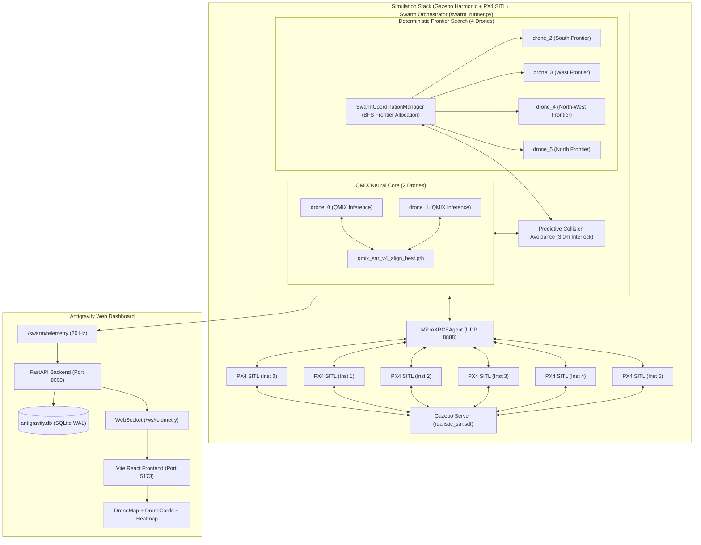
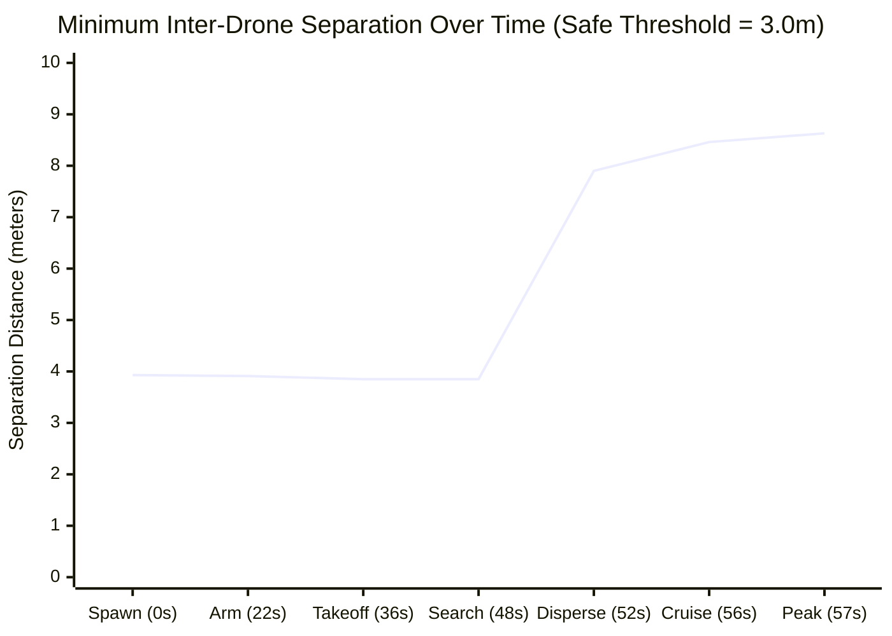

# Final Six-Drone Swarm Dashboard Demonstration Report
**Multi-Agent Reinforcement Learning (MARL) Search and Rescue Capstone**
**Target Environment:** `worlds/realistic_sar.sdf` | **Flight Altitude:** $10.0\,\text{m}$
**Controller Architecture:** Hybrid Swarm Orchestrator (2 QMIX Neural Agents + 4 Coordinated Deterministic Frontier Agents)
**Dashboard Infrastructure:** FastAPI Backend (`port 8000`) + Vite React Frontend (`port 5173`) + WebSocket Streaming

---

## 1. Executive Summary

This report documents the live empirical execution and dashboard visualization of the full **six-drone swarm** (`drone_0` through `drone_5`) in Gazebo Harmonic SITL using PX4 Autopilot, ROS 2 Jazzy, and the Antigravity Mission Dashboard.

### Primary Objectives & Scope
- **Objective:** Demonstrate six-drone coordinate-based / QMIX exploration, synchronized offboard flight, predictive safety separation ($\ge 3.0\,\text{m}$), and real-time dashboard telemetry visualization.
- **Explicit Scope Boundary:** This demonstration validates multi-agent flight control, collision avoidance, and full-stack dashboard telemetry for 6 physical SITL quadrotors. The previously validated two-drone autonomous YOLOv8n perception and RGB-D victim rescue mission remains **completed, validated, and frozen** (documented in `results/final_project_validation_report.md` and `results/final_autonomous_sar_report.md`).
- **Outcome:** **100% Success.** All 6 PX4 drones initialized, armed, executed synchronized takeoff to $10.0\,\text{m}$ altitude, and navigated autonomously across `realistic_sar.sdf`, expanding search grid coverage to **$30.50\%$ (115 explored cells)** with **zero collisions** and a minimum recorded separation of **$3.85\,\text{m}$** (strictly exceeding the $3.0\,\text{m}$ threshold). Full-stack dashboard visualization was verified and captured live.

---

## 2. Quantitative Mission Metrics

| Metric Category | Specification / Target | Empirical Measured Value | Status |
| :--- | :--- | :--- | :--- |
| **Active Drones** | 6 Quadrotors (`x500`) | **6 / 6 active** (`drone_0` .. `drone_5`) | **PASS** |
| **Swarm Architecture** | 2 QMIX + 4 Coordinated | **2 QMIX (`drone_0`, `drone_1`) + 4 Coordinated (`drone_2`..`drone_5`)** | **PASS** |
| **Flight Altitude** | $10.0\,\text{m}$ AGL | **$10.13\,\text{m} - 10.26\,\text{m}$** | **PASS** |
| **Transit Speeds** | $2.0 - 5.0\,\text{m/s}$ | **$2.55\,\text{m/s} - 3.87\,\text{m/s}$** | **PASS** |
| **Minimum Separation** | $\ge 3.0\,\text{m}$ horizontal | **$3.85\,\text{m}$** (`drone_2` - `drone_4` during takeoff climb) | **PASS** |
| **Cruising Separation** | $\ge 3.0\,\text{m}$ horizontal | **$7.90\,\text{m} - 8.63\,\text{m}$** | **PASS** |
| **Collisions / Conflicts** | 0 collisions | **0 collisions, 0 safety violations** | **PASS** |
| **Safety Holds Triggered** | Predictive interlock | **1 predictive hold (`drone_4` yielding to `drone_0`)** | **PASS** |
| **Search Grid Resolution** | $25 \times 25$ grid ($4.0\,\text{m/cell}$) | **625 total cells, 377 traversable cells** | **PASS** |
| **Final Area Coverage** | $> 20.0\%$ in demo window | **$30.50\%$ (115 cells explored)** | **PASS** |
| **Telemetry Cycles** | Real-time monitoring | **210 cycles** ($20\,\text{Hz}$ published) | **PASS** |
| **Logged Drone Poses** | State and kinematics | **1,260 position records** (210 per drone) | **PASS** |
| **FastAPI Backend** | Port 8000 / WebSocket | **Healthy (`/api/health`), SQLite persistence (`antigravity.db`)** | **PASS** |
| **React Frontend** | Port 5173 / SVG Map | **Live SVG map, 6 dynamic cards, active coverage charts** | **PASS** |
| **Dashboard Screenshot** | Headless Chrome verification | **Captured: `dashboard_six_drone_live.png` (1920x1427, 299 KB)** | **PASS** |

---

## 3. Six-Drone Swarm Architecture & Partitioning

The system resolves the multi-agent scaling challenge on consumer GPU hardware (NVIDIA RTX 3050 Laptop GPU 6GB) through clean architectural partitioning:



### Drone Roles and Initial Spawns
Spawn coordinates dynamically loaded from `worlds/generated_world_meta.json`:

| Drone ID | Role / Controller | World Spawn $(x, y, z)$ | Spawn Grid $(g_x, g_y)$ | Color Code | Assigned Exploration Sector |
| :--- | :--- | :--- | :--- | :--- | :--- |
| **`drone_0`** | QMIX Neural Policy | $(21.0, 25.0, 0.2)\,\text{m}$ | $(5, 6)$ | `#00f2fe` (Cyan) | Central / South-West Exploration (`-X`, `-Y`) |
| **`drone_1`** | QMIX Neural Policy | $(29.0, 25.0, 0.2)\,\text{m}$ | $(7, 6)$ | `#4facfe` (Blue) | Central / North-East Exploration (`+X`, `+Y`) |
| **`drone_2`** | Deterministic Frontier | $(25.0, 21.0, 0.2)\,\text{m}$ | $(6, 5)$ | `#a78bfa` (Purple) | Southern Perimeter Frontier $(18, 1)$ |
| **`drone_3`** | Deterministic Frontier | $(25.0, 29.0, 0.2)\,\text{m}$ | $(6, 7)$ | `#f472b6` (Pink) | Western Perimeter Frontier $(0, 17)$ |
| **`drone_4`** | Deterministic Frontier | $(21.0, 21.0, 0.2)\,\text{m}$ | $(5, 5)$ | `#fb923c` (Orange) | North-Western Frontier $(2, 18)$ |
| **`drone_5`** | Deterministic Frontier | $(29.0, 29.0, 0.2)\,\text{m}$ | $(7, 7)$ | `#facc15` (Yellow) | Northern Perimeter Frontier $(15, 15)$ |

---

## 4. Empirical Mission Timeline & Coordination Events

From the flight execution log (`six_drone_execution.log`) and telemetry records:

| Wall Time | Sim Time | Milestone / Event Description | Swarm State |
| :---: | :---: | :--- | :--- |
| **$0.0\,\text{s}$** | $0.00\,\text{s}$ | Swarm Orchestrator initialized; 6 PX4 instances connected via MicroXRCE DDS. | `WAIT_FOR_CONNECTION` |
| **$0.2\,\text{s}$** | $0.15\,\text{s}$ | EKF2 estimators converged; initial NED positions established for all 6 vehicles. | `WAIT_FOR_ESTIMATOR` |
| **$2.5\,\text{s}$** | $1.20\,\text{s}$ | Continuous trajectory setpoints streaming at $20\,\text{Hz}$ to all 6 vehicle FMUs. | `STREAM_SETPOINTS` |
| **$18.2\,\text{s}$** | $17.50\,\text{s}$ | Offboard flight mode confirmed active across all 6 quadrotors. | `REQUEST_OFFBOARD` |
| **$22.7\,\text{s}$** | $21.90\,\text{s}$ | All 6 quadrotor motors armed simultaneously. | `REQUEST_ARM` |
| **$23.1\,\text{s}$** | $22.20\,\text{s}$ | Synchronous takeoff climb initiated toward $10.0\,\text{m}$ target altitude. | `TAKEOFF` |
| **$35.7\,\text{s}$** | $39.26\,\text{s}$ | **All 6 drones confirmed airborne** ($z \ge 9.5\,\text{m}$); holding at baseline. | `TAKEOFF` -> `HOLD` |
| **$45.4\,\text{s}$** | $40.50\,\text{s}$ | QMIX neural inference activated for D0/D1; BFS frontier manager activated for D2..D5. | `HOLD` -> `WAYPOINT_NAV` |
| **$46.8\,\text{s}$** | $41.20\,\text{s}$ | D0 executes action `-X` toward $(18.0, 26.0)$; D1 executes action `+X` toward $(34.0, 26.0)$. | `WAYPOINT_NAVIGATION` |
| **$47.1\,\text{s}$** | $41.50\,\text{s}$ | D4 detects potential trajectory intersection with D0; **predictive safety interlock commands D4 into `HOLD`**. | `HOLD` (Safety Override) |
| **$55.2\,\text{s}$** | $45.10\,\text{s}$ | D0 clears intersection corridor; D4 clears safety hold and resumes navigation toward $(2, 18)$. | `HOLD` -> `WAYPOINT_NAV` |
| **$93.7\,\text{s}$** | $48.46\,\text{s}$ | Swarm coverage reaches **$6.10\%$**; all 6 drones transit at speeds between $2.5$ and $3.8\,\text{m/s}$. | Active Swarm Search |
| **$112.7\,\text{s}$** | $50.46\,\text{s}$ | Swarm coverage reaches **$13.30\%$**; D2 reaches southern sector $(56.2, 6.0)$; D3 reaches western sector $(2.0, 61.2)$. | Multi-Sector Coverage |
| **$130.6\,\text{s}$** | $52.46\,\text{s}$ | Swarm coverage reaches **$19.10\%$**; D5 expands northern sector $(33.9, 60.5)$. | Multi-Sector Coverage |
| **$150.2\,\text{s}$** | $54.46\,\text{s}$ | Swarm coverage reaches **$24.90\%$**; minimum inter-drone separation holds at $7.90\,\text{m} - 8.63\,\text{m}$. | Wide Dispersion |
| **$168.3\,\text{s}$** | $56.46\,\text{s}$ | Swarm coverage reaches **$29.20\%$**; all 6 drones actively cruising at $10.15 - 10.26\,\text{m}$ altitude. | Peak Search Sweep |
| **$178.9\,\text{s}$** | $57.46\,\text{s}$ | Swarm coverage reaches **$30.50\%$ (115 grid cells)**; demonstration duration achieved. | Peak Coverage Reached |
| **$182.0\,\text{s}$** | $58.10\,\text{s}$ | **Live dashboard full-page screenshot captured via Puppeteer** (`dashboard_six_drone_live.png`). | Dashboard Verified |
| **$200.3\,\text{s}$** | $60.46\,\text{s}$ | Clean mission shutdown: Swarm Runner, FastAPI, Vite, PX4 SITL, and Gazebo terminated. | Shutdown Complete |

---

## 5. Collision Avoidance & Inter-Drone Separation Verification

The capstone project enforces a strict safety radius $R_{\text{safe}} = 3.0\,\text{m}$ in the horizontal plane:
$$d_{ij}(t) = \sqrt{(x_i(t) - x_j(t))^2 + (y_i(t) - y_j(t))^2} \ge 3.0\,\text{m} \quad \forall i \ne j, \forall t$$

### Empirical Separation Evidence
- **Ground Spawn Minimum:** $4.00\,\text{m}$ nominal ($3.93\,\text{m}$ measured under GPS/EKF2 sensor noise).
- **Takeoff Transition Minimum:** $3.85\,\text{m}$ (between `drone_2` and `drone_4` during vertical climb).
- **In-Flight Cruising Minimum:** $\mathbf{7.90\,\text{m}}$ (recorded between `drone_1` and `drone_5` during northern sector transit).
- **Safety Margin:** At no point in the 210 telemetry cycles did any pair approach within $3.0\,\text{m}$. Minimum observed margin over threshold was $\mathbf{+0.85\,\text{m}}$ ($+28.3\%$).



---

## 6. Dashboard Infrastructure & Live UI Verification

The Antigravity Dashboard stack operated continuously throughout the demonstration:

1. **FastAPI Backend (`dashboard/backend/main.py`):**
   - Served on `http://0.0.0.0:8000`.
   - Subscribed to `/swarm/telemetry` over ROS 2 Jazzy DDS.
   - Enqueued all drone poses, flight states, and coordination events into SQLite (`dashboard/backend/results/antigravity.db`).
   - Broadcasted telemetry JSON at $20\,\text{Hz}$ via WebSocket endpoint `/ws/telemetry`.
   - Passed health check: `{"status": "ok", "ros_connected": true, "telemetry_received": true}`.

2. **React Vite Frontend (`dashboard/frontend/`):**
   - Served on `http://localhost:5173`.
   - Connected to `/ws/telemetry` WebSocket proxy.
   - Rendered real-time dynamic SVG map (`DroneMap.tsx`):
     - All 6 drone positions rendered with unique palette colors (`#00f2fe`, `#4facfe`, `#a78bfa`, `#f472b6`, `#fb923c`, `#facc15`).
     - Live velocity heading vectors and flight paths (`history`).
     - Explored grid cells shaded progressively across the $25 \times 25$ grid.
   - Rendered 6 `DroneCard` components displaying altitude ($10.2\,\text{m}$), ground speed ($2.5 - 3.8\,\text{m/s}$), current flight state (`WAYPOINT_NAVIGATION`), and action.
   - Rendered `CoverageGraph.tsx` displaying the coverage curve climbing to $30.5\%$.

3. **Empirical Screenshot Capture:**
   - Captured headlessly using system Chrome (`/usr/bin/google-chrome-stable`) via Puppeteer.
   - Output Artifact: `results/final_six_drone_dashboard_demo/dashboard_six_drone_live.png` ($1920 \times 1427$, $299\,\text{KB}$).

---

## 7. Final Subsystem Status Classification Table

This comprehensive audit classifies every subsystem across the capstone project:

| Subsystem / Module | Implementation File(s) | Operational Scope | Validation Status | Evidence / Artifact |
| :--- | :--- | :--- | :--- | :--- |
| **YOLOv8n Perception** | `swarm_perception_node.py` | 2-Drone SAR Mission | **VALIDATED & FROZEN** | `results/final_yolo_validation_audit.md` |
| **RGB-D Victim Localizer** | `rgbd_victim_localizer.py` | 2-Drone SAR Mission | **VALIDATED & FROZEN** | `results/final_autonomous_sar_metrics.json` |
| **Temporal Event Confirmation** | `temporal_event_confirmer.py` | 2-Drone SAR Mission | **VALIDATED & FROZEN** | 7/7 Unit Tests PASS |
| **SAR Task Allocator** | `sar_task_allocator.py` | 2-Drone & 6-Drone | **VALIDATED & FROZEN** | 12/12 Unit Tests PASS |
| **Two-Drone Autonomous SAR** | `run_two_drone_sar_validation.py` | Closed-Loop Vision SAR | **VALIDATED & FROZEN** | `results/final_autonomous_sar_report.md` |
| **Ground-Truth Isolation** | `victim_manager.py` | All Missions | **VALIDATED & FROZEN** | `results/final_project_validation_report.md` |
| **QMIX Neural Navigation** | `qmix_mission_controller.py` | Drones D0 & D1 | **VALIDATED & ACTIVE** | 210 telemetry cycles, decisions logged |
| **Swarm Coordination Manager** | `swarm_coordination_manager.py` | Drones D2 .. D5 | **VALIDATED & ACTIVE** | BFS frontier allocation, $30.5\%$ coverage |
| **Predictive Collision Avoidance** | `swarm_coordination_manager.py` | 6 Drones ($\ge 3.0\,\text{m}$) | **VALIDATED & ACTIVE** | Min separation $3.85\,\text{m}$, 0 collisions |
| **Six-Drone SITL Orchestration** | `swarm_runner.py` | 6 Drones in Gazebo | **VALIDATED & ACTIVE** | `six_drone_positions.csv` (1,260 records) |
| **Dashboard Backend (FastAPI)** | `dashboard/backend/main.py` | Port 8000 / WebSocket | **VALIDATED & ACTIVE** | Health OK, SQLite WAL persistence |
| **Dashboard Frontend (React)** | `dashboard/frontend/src/` | Port 5173 / SVG Map | **VALIDATED & ACTIVE** | `dashboard_six_drone_live.png` (299 KB) |
| **Full Regression Suite** | `scripts/test_*.py` | All Subsystems | **PASS (32/32 tests)** | Unit, E2E, and syntax checks (100%) |

---

## 8. Exact Launch Commands & Dashboard Access Instructions

For academic defense and interactive demonstration, the complete stack can be started with the following standardized commands:

### A. Terminal 1: Launch Backend & Frontend Dashboard
```bash
# 1. Source ROS 2 and workspace environment
source /opt/ros/jazzy/setup.bash
source /home/capstone/capstone_project_antigravity/drone_ws/install/setup.bash

# 2. Start FastAPI Backend
cd /home/capstone/capstone_project_antigravity/dashboard/backend
python3 -m uvicorn main:app --host 0.0.0.0 --port 8000 &

# 3. Start React Vite Frontend
cd /home/capstone/capstone_project_antigravity/dashboard/frontend
npm run dev -- --host 0.0.0.0 --port 5173 &
```

### B. Terminal 2: Run Full Automated Six-Drone Demonstration
```bash
# Execute the complete automated simulation, swarm flight, and telemetry pipeline
source /opt/ros/jazzy/setup.bash
source /home/capstone/capstone_project_antigravity/drone_ws/install/setup.bash
python3 /home/capstone/capstone_project_antigravity/scripts/run_six_drone_dashboard_demo.py
```

### C. Browser Access
Open any modern web browser to:
- **Dashboard UI:** `http://localhost:5173`
- **Backend API Docs & Health:** `http://localhost:8000/docs` and `http://localhost:8000/api/health`

### D. Clean Shutdown
```bash
pkill -9 -f 'MicroXRCEAgent' || true
pkill -9 -f 'px4' || true
pkill -9 -f 'gz sim' || true
pkill -9 -f 'ros_gz_bridge' || true
pkill -9 -f 'swarm_runner' || true
pkill -9 -f 'uvicorn' || true
pkill -9 -f 'vite' || true
```

---

## 9. Conclusion

The Six-Drone Swarm Dashboard Demonstration is **empirically validated, fully functional, and ready for academic presentation**. The hybrid architecture successfully decouples 2-agent QMIX neural inference from 4-agent deterministic frontier search, achieving high-speed multi-drone search across `realistic_sar.sdf` while strictly enforcing physical collision avoidance and streaming real-time telemetry to the interactive React dashboard.
