# Production-World Integration Verification Report
## Autonomous Perception & SAR Response Pipeline Across Simulation Environments

**Document Purpose:** Read-only architectural and runtime integration audit of the autonomous vision-perception and victim-response pipeline.  
**Audit Date:** November 3, 2026  
**Audited Environments:**
1. Urban Disaster Theater: [`worlds/realistic_sar.sdf`](file:///home/capstone/capstone_project_antigravity/worlds/realistic_sar.sdf) (Primary Active World)
2. Large-Scale Earthquake City: [`worlds/earthquake_world.sdf`](file:///home/capstone/capstone_project_antigravity/worlds/earthquake_world.sdf) (Candidate World)
3. Wilderness Mountain Forest: [`worlds/forest_sar.sdf`](file:///home/capstone/capstone_project_antigravity/worlds/forest_sar.sdf) (Cross-Environment World)

---

## 1. Executive Summary & Verification Matrix

| Evaluation Dimension | `realistic_sar.sdf` | `earthquake_world.sdf` | `forest_sar.sdf` |
| :--- | :--- | :--- | :--- |
| **1. Gazebo Sensor Configuration** | Configured via `x500_rgbd_down` (5 Hz, $640\times 480$, Nadir $-90^\circ$) | Configured via `x500_rgbd_down` (5 Hz, $640\times 480$, Nadir $-90^\circ$) | Configured via `x500_rgbd_down` / `x500_multispectral` |
| **2. ROS 2 Transport & Bridges** | Complete (`ros_gz_bridge` + parameter bridge topics) | Partial (Launch branch present; dashboard registry missing) | Complete (`ros_gz_bridge` + forest velocity tuning) |
| **3. Autonomous Perception Stack** | Fully wired (`swarm_perception_node` $\to$ `rgbd_victim_localizer`) | Wired in code, but **ZERO victims** exist to detect | Wired, but challenged by aerial nadir misclassification |
| **4. SAR Task Allocation & Response** | Fully implemented (`SARTaskAllocator` $\to$ `SwarmCoordination`) | Implemented in code, but inactive due to 0 victims | Implemented in code; smoke-tested in Gazebo |
| **5. Ground-Truth Isolation** | **STRICTLY ENFORCED** (Autonomous pipeline isolated from GT) | Theoretically isolated, but moot (0 GT victims) | **STRICTLY ENFORCED** (Autonomous pipeline isolated from GT) |
| **6. Runtime Verification Status** | **PARTIALLY INTEGRATED** | **NOT INTEGRATED** | **PARTIALLY INTEGRATED** |

---

## 2. In-Depth Environment Audit: `worlds/realistic_sar.sdf`

### 2.1 Gazebo Sensor Configuration
- **Sensor Placement Architecture:** Sensors are not defined directly in `realistic_sar.sdf` (which contains only the environment geometry: 87 models including buildings, rubble piles, roads, and 5 victim models). Sensors are mounted on the simulated UAV platform spawned by PX4 SITL.
- **Drone Sensor Model:** [`models/x500_rgbd_down/model.sdf`](file:///home/capstone/capstone_project_antigravity/models/x500_rgbd_down/model.sdf) (or [`models/x500_multispectral/model.sdf`](file:///home/capstone/capstone_project_antigravity/models/x500_multispectral/model.sdf)).
- **Mount Pose & Orientation:** Rigidly mounted to `base_link` at `camera_link` pose `<pose>0.03 0 0 0 1.5707 0</pose>`, establishing a fixed nadir (downward-pointing, $-90^\circ$ pitch) optical perspective.
- **Sensor Specifications:**
  - Type: `rgbd_camera` (combines RGB optical array and structured depth buffer).
  - Horizontal Field of View (FOV): $1.74\text{ rad} \approx 99.7^\circ$.
  - Resolution: $640 \times 480$ pixels.
  - Clipping Bounds: Near $= 0.1\text{ m}$, Far $= 40.0\text{ m}$.
  - Update Rate: $5\text{ Hz}$.
  - Gazebo Transport Topics:
    - `/world/realistic_sar/model/x500_rgbd_down_{i}/link/camera_link/sensor/camera/image`
    - `/world/realistic_sar/model/x500_rgbd_down_{i}/link/camera_link/sensor/camera/depth_image`
    - `/world/realistic_sar/model/x500_rgbd_down_{i}/link/camera_link/sensor/camera/camera_info`
    - `/model/x500_rgbd_down_{i}/pose`

### 2.2 ROS 2 Integration & Transport Bridge
- **Bridge Implementation:** [`scripts/launch_swarm_rgbd.sh`](file:///home/capstone/capstone_project_antigravity/scripts/launch_swarm_rgbd.sh) lines 171–199 launch `ros_gz_bridge parameter_bridge`.
- **Topic Mapping & Message Types:**
  - Color Stream: `/drone_{i}/camera/image` (`sensor_msgs/msg/Image`, encoding `bgr8`/`rgb8`).
  - Depth Stream: `/drone_{i}/camera/depth_image` (`sensor_msgs/msg/Image`, encoding `32FC1`, units: meters).
  - Intrinsics Stream: `/drone_{i}/camera/camera_info` (`sensor_msgs/msg/CameraInfo`).
  - Odometry & Pose: `/model/drone_{i}/pose` (`geometry_msgs/msg/PoseStamped`) and `/drone_{i}/fmu/out/vehicle_odometry` (`px4_msgs/msg/VehicleOdometry`).
  - Simulation Clock: `/clock` (`rosgraph_msgs/msg/Clock`).
- **Required Runtime Nodes:**
  1. `MicroXRCEAgent udp4 -p 8888` (uORB DDS bridge).
  2. `ros_gz_bridge parameter_bridge` (Gazebo-to-ROS sensor transport).
  3. `swarm_perception_node.py` (Centralized GPU batched YOLO inference).
  4. `rgbd_victim_localizer.py` (or `rgb_thermal_fusion_verifier.py`).
  5. `swarm_runner` executing `SwarmOrchestratorNode` (`qmix_mission_controller.py` + `swarm_coordination_manager.py`).

### 2.3 Autonomous Perception Pipeline
- **YOLO Model Loading:** [`swarm_perception_node.py`](file:///home/capstone/capstone_project_antigravity/drone_ws/src/swarm_controller/swarm_controller/swarm_perception_node.py) loads `models/yolov8n.pt` onto `cuda:0` (device fallback: `cpu`).
- **Inference & Gating:** Ingests `/drone_{i}/camera/image`, executes GPU batched inference, filters strictly for COCO class 0 (`person`), rejecting non-human classes.
- **Candidate Publishing:** Publishes candidate bounding boxes to `/drone_{i}/perception/detections` (`std_msgs/msg/String` JSON).
- **RGB-D Localization:** [`rgbd_victim_localizer.py`](file:///home/capstone/capstone_project_antigravity/drone_ws/src/swarm_controller/swarm_controller/rgbd_victim_localizer.py) extracts median depth from a central $30\%$ patch of the bounding box and projects pixel coordinates $(u, v)$ to world coordinates $(x_w, y_w)$ via pinhole raycasting and drone yaw rotation.
- **Temporal Event Confirmation:** [`temporal_event_confirmer.py`](file:///home/capstone/capstone_project_antigravity/drone_ws/src/swarm_controller/swarm_controller/temporal_event_confirmer.py) maintains a sliding consensus window ($K = 4$ confirmations out of $N = 6$ frames spanning $\ge 0.4\text{ s}$).
- **Confirmed Event Publishing:** Emits `/sar/victim_discovery` (`std_msgs/msg/String` JSON) containing autonomous track ID, localized coordinates, and confidence.

### 2.4 SAR Response & Task Allocation
- **Ingestion:** [`qmix_mission_controller.py`](file:///home/capstone/capstone_project_antigravity/drone_ws/src/swarm_controller/swarm_controller/qmix_mission_controller.py) lines 151–222 subscribe to `/sar/victim_discovery`.
- **Autonomous Track Persistence:** Validated discovery payloads are ingested into `victim_manager.process_discovery_event()`, populating `victim_manager.tracked_victims`.
- **Task Creation & 1-to-1 Mapping:** [`sar_task_allocator.py`](file:///home/capstone/capstone_project_antigravity/drone_ws/src/swarm_controller/swarm_controller/sar_task_allocator.py) instantiates `SARTask` objects and advances the state machine (`DISCOVERED` $\to$ `ASSIGNED` $\to$ `APPROACHING` $\to$ `INVESTIGATING` $\to$ `COMPLETED`).
- **Physical Drone Routing:** [`swarm_coordination_manager.py`](file:///home/capstone/capstone_project_antigravity/drone_ws/src/swarm_controller/swarm_controller/swarm_coordination_manager.py) lines 245–365 check `task_allocator.get_assigned_task_for_drone()`. When a task is assigned, the deterministic drone's navigation setpoint is steered directly to $(assigned\_task.grid\_x, assigned\_task.grid\_y)$, overriding standard frontier exploration.

### 2.5 Ground-Truth Isolation Verification
- **Autonomous Pipeline Audit:** At no point in the detection, localization, tracking, or task allocation chain are ground-truth coordinates (`victim_manager.victims` or `metadata["victims"]`) referenced. Autonomous tracks are instantiated with independent sequential IDs (`victim_0`, `victim_1`, etc.) based strictly on camera ray intersections.
- **Privileged Proximity Detector Decoupling:** In `qmix_mission_controller.py` lines 100–130, the 15m proximity detector reads `self.victim_manager.victims` solely to write ground-truth benchmarks to `victim_detection.csv`. It does NOT publish to `/sar/victim_discovery` or feed `SARTaskAllocator`.
- **Post-Hoc Isolation:** Authoritative academic metrics are computed post-hoc by [`ground_truth_matcher.py`](file:///home/capstone/capstone_project_antigravity/drone_ws/src/swarm_controller/swarm_controller/ground_truth_matcher.py) via the Hungarian algorithm after mission completion.

### 2.6 Runtime Verification Status
- **Empirical Evidence in Workspace:**
  - Flight physics, SITL PX4 navigation, QMIX policy execution, and rule-based safety shielding are proven in raw CSV logs ([`results/h7_v4_physical/`](file:///home/capstone/capstone_project_antigravity/results/h7_v4_physical/) and [`results/final_research_package/`](file:///home/capstone/capstone_project_antigravity/results/final_research_package/)).
  - The complete perception-to-task pipeline was verified in regression testing ([`scripts/test_phase3d_e2e_integration.py`](file:///home/capstone/capstone_project_antigravity/scripts/test_phase3d_e2e_integration.py), 9/9 tests passed).
  - Single-drone visual localization was validated in Gazebo ([`results/final_yolo_validation.csv`](file:///home/capstone/capstone_project_antigravity/results/final_yolo_validation.csv)).
  - *Limitation:* A full-duration live 6-drone flight in `realistic_sar.sdf` where drones navigate exclusively via autonomous vision discoveries (rather than proximity scoring) has not been run to completion.
- **Classification:** **PARTIALLY INTEGRATED** (Source complete, architecture configured, component-level runtime verified, end-to-end multi-drone closed-loop flight validation pending).

---

## 3. In-Depth Environment Audit: `worlds/earthquake_world.sdf`

### 3.1 Gazebo Sensor Configuration
- **World Content:** `worlds/earthquake_world.sdf` is a 372 KB file containing 570 static obstacle models (collapsed apartment complexes, construction rubble, damaged commercial blocks).
- **Sensors:** Contains **no sensors** defined in the world file itself. Drones would be spawned via PX4 SITL using `x500_rgbd_down` if launched with `scripts/launch_swarm_rgbd.sh earthquake_world`.

### 3.2 ROS 2 Integration & Transport Bridge
- **Launch Script Support:** [`scripts/launch_swarm_rgbd.sh`](file:///home/capstone/capstone_project_antigravity/scripts/launch_swarm_rgbd.sh) lines 53–55 contain a shell branch:
  ```bash
  elif [ "$MAP_ID" == "earthquake_world" ]; then
      META_FILE="$WORKSPACE_DIR/worlds/earthquake_world_meta.json"
      export PX4_GZ_WORLD="earthquake_world"
  ```
  This branch dynamically builds ROS-Gazebo bridge topics under `/world/earthquake_world/...`.
- **CRITICAL DEFECT — Missing from Dashboard Registry:**
  In [`dashboard/backend/world.py`](file:///home/capstone/capstone_project_antigravity/dashboard/backend/world.py), `MAP_REGISTRY` contains only `"realistic_sar"`, `"forest_sar"`, and `"forest_dense_candidate"`.
  `"earthquake_world"` is **completely absent from `MAP_REGISTRY`**.
  Calling `/api/world/earthquake_world` returns:
  ```json
  {"error": "Map not found in registry."}
  ```
  The dashboard UI cannot display, select, or trigger missions in `earthquake_world`.

### 3.3 Autonomous Perception Pipeline
- **Node Generality:** `swarm_perception_node.py` and `rgbd_victim_localizer.py` are node-agnostic and could process camera topics from `earthquake_world`.
- **CRITICAL DEFECT — Zero Victims Present:**
  An audit of [`worlds/earthquake_world_meta.json`](file:///home/capstone/capstone_project_antigravity/worlds/earthquake_world_meta.json) reveals:
  ```json
  "victims": []
  ```
  Furthermore, a string search of `worlds/earthquake_world.sdf` confirms **zero victim models** are defined in the SDF file.
  Because no victim models exist in the environment or metadata, the vision pipeline would scan an environment containing exclusively buildings and debris, yielding zero human candidate detections.

### 3.4 SAR Response & Task Allocation
- In `qmix_mission_controller.py` lines 273–274, `map_id = "earthquake_world"` is recognized.
- However, `victim_manager.parse_metadata()` receives `victims: []`.
- `victim_manager.victims` remains empty (`{}`).
- `victim_manager.spawn_all()` spawns zero victims into Gazebo.
- Because no victims can be detected, `sar_task_allocator.py` receives zero discovery events, and no victim inspection tasks can ever be generated or allocated.

### 3.5 Ground-Truth Isolation Verification
- While the software architecture maintains separate variables, the question of ground-truth isolation is moot in `earthquake_world` because ground-truth victim count is identically zero.

### 3.6 Runtime Verification Status
- **Empirical Evidence in Workspace:**
  - There are **zero runtime logs**, zero trajectory CSV files, zero mission records, and zero telemetry dumps for `earthquake_world` anywhere in `results/`, `analysis/`, or `dashboard/backend/results/antigravity.db`.
  - The historical audit in [`N3_READONLY_ARCHITECTURAL_INSPECTION.md`](file:///home/capstone/capstone_project_antigravity/N3_READONLY_ARCHITECTURAL_INSPECTION.md) documented:
    `"Quantitative Validation: NONE. The environment is strictly unvalidated."`
- **Classification:** **NOT INTEGRATED** (Zero victim models, empty metadata victims array, unregistered in dashboard backend, zero empirical runtime execution).

---

## 4. In-Depth Environment Audit: `worlds/forest_sar.sdf`

### 4.1 Gazebo Sensor Configuration
- **World Content:** `worlds/forest_sar.sdf` is a 1.25 MB procedural wilderness world containing 1,118 models (trees, boulders, campsites) and a $500\text{ m} \times 500\text{ m}$ elevation heightmap.
- **Sensors:** Uses simulated UAV platform `x500_rgbd_down` or `x500_multispectral` (dual RGB-D + Radiometric Thermal LWIR).
- **Victim Content:** 5 human victim models (`casual_female`) placed on the ground terrain at coordinates defined in `worlds/forest_sar_meta.json`.

### 4.2 ROS 2 Integration & Transport Bridge
- **Registered in Dashboard:** Fully registered in [`dashboard/backend/world.py`](file:///home/capstone/capstone_project_antigravity/dashboard/backend/world.py) (`MAP_REGISTRY["forest_sar"]` with $25 \times 25$ grid, $8.0\text{ m}$ cell size, origin $(-180.0, -20.0)$).
- **Launch Infrastructure:** Supported in [`scripts/launch_swarm_rgbd.sh`](file:///home/capstone/capstone_project_antigravity/scripts/launch_swarm_rgbd.sh) with high-speed kinematic parameters (`MPC_XY_CRUISE=12.0`, `MPC_XY_VEL_MAX=16.0`, `MPC_ACC_HOR=6.0`).

### 4.3 Autonomous Perception Pipeline
- **Single-Drone Proof of Concept:** Empirically verified in [`docs/VISION_PERCEPTION_INTEGRATION_REPORT.md`](file:///home/capstone/capstone_project_antigravity/docs/VISION_PERCEPTION_INTEGRATION_REPORT.md) (Oct 22). A downward camera detected `casual_female` at $(-46.88, 99.61)$ with $conf = 0.834$ and localization error of $2.6\text{ cm}$.
- **Swarm Flight Domain Gap:** In full swarm smoke tests ([`docs/dense_forest_evaluation_audit.md`](file:///home/capstone/capstone_project_antigravity/docs/dense_forest_evaluation_audit.md)), off-the-shelf YOLOv8n classified downward views of victims as `bird` (class 14, conf $0.71 - 0.87$). Because `swarm_perception_node.py` strictly filters for class 0 (`person`), these detections were discarded, preventing discovery event emission during swarm flight.

### 4.4 SAR Response & Task Allocation
- Ingests into `victim_manager.tracked_victims`, allocates via `sar_task_allocator.py`, and steers deterministic drones via `swarm_coordination_manager.py`.
- Verified in unit and integration test harnesses (`scripts/test_sar_task_allocation.py`, `scripts/test_phase3d_e2e_integration.py`).

### 4.5 Ground-Truth Isolation Verification
- **Verified:** Fully isolated. Grid bounds ($[-180.0, -20.0]$, cell $8.0\text{ m}$) are configured into `GridWorldTransform`. Autonomous localizer computes world coordinates from depth rays without accessing metadata victim coordinates.

### 4.6 Runtime Verification Status
- **Empirical Evidence in Workspace:**
  - Multiple recorded Gazebo flight sessions exist in [`results/forest_simulation_recording_20261025_113850/`](file:///home/capstone/capstone_project_antigravity/results/forest_simulation_recording_20261025_113850/) and `20261025_135304/`.
  - Smoke tests executed in [`results/single_seed_live_validation_forest_dense_candidate/`](file:///home/capstone/capstone_project_antigravity/results/single_seed_live_validation_forest_dense_candidate/).
  - *Limitation:* The aerial nadir misclassification gap prevents full closed-loop visual task allocation during autonomous swarm flights.
- **Classification:** **PARTIALLY INTEGRATED** (Full configuration present, physics and single-drone vision verified in Gazebo, full swarm visual discovery limited by COCO top-down classification gap).

---

## 5. Comparative Environment Classification & Final Verdict

```mermaid
flowchart TD
    subgraph realistic_sar [realistic_sar.sdf]
        R1[Sensors & Bridges: COMPLETE] --> R2[Perception Pipeline: WIRED]
        R2 --> R3[Task Allocation: WIRED]
        R3 --> R4[Ground Truth: ISOLATED]
        R4 --> R5[Status: PARTIALLY INTEGRATED]
    end

    subgraph earthquake_world [earthquake_world.sdf]
        E1[Sensors: Drone mount only] --> E2[Dashboard Registry: MISSING]
        E2 --> E3[Victims in World: ZERO]
        E3 --> E4[Metadata Victims: EMPTY]
        E4 --> E5[Status: NOT INTEGRATED]
    end

    subgraph forest_sar [forest_sar.sdf]
        F1[Sensors & Bridges: COMPLETE] --> F2[Dashboard Registry: PRESENT]
        F2 --> F3[Single-Drone Vision: VERIFIED]
        F3 --> F4[Swarm Top-Down Vision: BIRD/KITE GAP]
        F4 --> F5[Status: PARTIALLY INTEGRATED]
    end
```



### Final Environment Classifications

1. **`worlds/realistic_sar.sdf` $\implies$ PARTIALLY INTEGRATED**
   - *Justification:* Ground-truth isolation, Gazebo-to-ROS bridges, YOLO perception node, RGB-D localization, temporal event confirmation, task allocation, and coordination are fully implemented in source code and passed all 9 regression tests in `test_phase3d_e2e_integration.py`. Flight physics, QMIX control, and proximity scoring are runtime-verified in historical benchmarks. However, a live 6-drone flight in this world driven end-to-end by autonomous vision discoveries remains to be executed.

2. **`worlds/earthquake_world.sdf` $\implies$ NOT INTEGRATED**
   - *Justification:* Although the SDF world file exists with 570 obstacle models, it contains **zero victim models**, its metadata file has an **empty victims array (`"victims": []`)**, and it is **completely omitted from `MAP_REGISTRY`** in `dashboard/backend/world.py`. The dashboard cannot launch or monitor it, and no victims can be detected or rescued. Zero empirical runtime telemetry exists for this environment.

3. **`worlds/forest_sar.sdf` $\implies$ PARTIALLY INTEGRATED**
   - *Justification:* Registered in the dashboard backend, supported in multi-drone launch scripts, and verified with single-drone Gazebo camera detection ($2.6\text{ cm}$ error). However, during full swarm flight, off-the-shelf YOLOv8n classifies top-down victim silhouettes as birds/kites, preventing the emission of `/sar/victim_discovery` events without thermal fusion or aerial fine-tuning.
